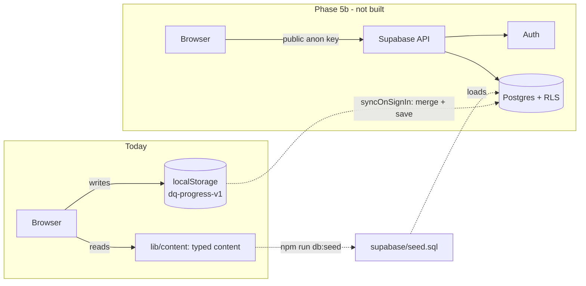
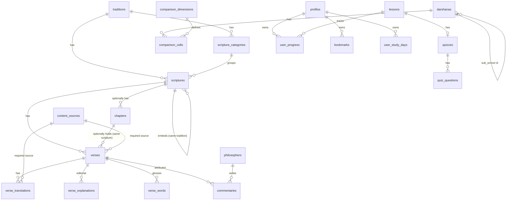

# DharmaQuest backend (Phase 5): design, security and how to apply it

> **Status: designed and tested locally. Not deployed.** Nothing here is connected to the website yet.
> No Supabase project exists, no keys are involved, and the site behaves exactly as before.
> Read "What has NOT been verified" before applying anything.

## 1. What exists

| Piece | Where | Tested by |
|---|---|---|
| Database schema (4 migrations) | `supabase/migrations/` | `supabase/tests/` (SQL, 227 assertions) |
| Seed generated from the site's real content | `supabase/seed.sql` (from `npm run db:seed`) | seed integrity + idempotency suites; "seed is up to date" test |
| Browser store (what runs today) | `lib/learning/store.ts` | `tests/store.test.ts` |
| Sign-in merge logic | `lib/learning/merge.ts` | `tests/merge.test.ts` (property tests) |
| Account repository (Supabase) | `lib/learning/repository.ts` | `tests/repository.test.ts` (against a fake) |
| Public config loader | `lib/supabase/config.ts` | `tests/config.test.ts` |
| Secret scan | n/a | `tests/no-secrets.test.ts` |

Run everything: `npm run check` (lint, types, TypeScript tests, database tests). The database tests need a local
PostgreSQL 15+ (`createdb`/`psql` on the PATH) with the `unaccent` and `pg_trgm` extensions (standard contrib).

## 2. Architecture



Content has one source of truth, the TypeScript modules. `npm run db:seed` turns them into an idempotent SQL seed,
so the database and the site cannot silently drift (a test fails if `seed.sql` is stale).

## 3. Data model

The 17 requested entities and where they live. `users` is Supabase's managed `auth.users` plus our `public.profiles`.

| Requested entity | Table(s) | Notes |
|---|---|---|
| traditions | `traditions`, `classifications` | Sanatan Dharma active; Islam, Christianity, Judaism, Buddhism exist as `planned` placeholders (hidden, empty) |
| scripture_categories | `scripture_categories`, `category_classifications` | tradition-scoped |
| scriptures | `scriptures`, `scripture_classifications`, `scripture_sources` | optional chapters/verses; may be embedded in another scripture |
| chapters | `chapters` | any named division: chapter, kanda, parva, skandha... |
| verses | `verses`, `verse_words` | every verse requires a source |
| verse_translations | `verse_translations` | translator + licence required to publish |
| verse_explanations | `verse_explanations` | DharmaQuest editorial only; never presented as commentary |
| commentaries | `commentaries` | attributed to a commentator and school; separate from editorial |
| philosophers | `philosophers`, `darshana_philosophers` | |
| darshanas | `darshanas`, `comparison_dimensions`, `comparison_cells` | `kind` = `darshana` or `sub_school` (with a parent) |
| concepts | `concepts`, `darshana_concepts`, `chapter_concepts`, `verse_concepts` | a global term; each school gives its own meaning |
| lessons / quizzes / quiz_questions | `lessons`, `quizzes`, `quiz_questions` | question shape validated by the database |
| users | `auth.users` + `profiles`, `editors` | profile auto-created at sign-up |
| user_progress | `user_progress`, `user_study_days` | streaks are computed, never stored |
| bookmarks | `bookmarks` | exactly one real foreign-key target |
| content_sources | `content_sources` | kind, licence, verification state |
| (extra) | `audit_log` | who changed sourced content, with before/after |



### Rules the database enforces (not just the UI)

| Rule | Mechanism |
|---|---|
| No verse without a source; the source must be a primary text, dataset or scholarly work | `NOT NULL` + trigger |
| Translations are filed under translation-kind sources only; editorial text cannot be filed as a translation or commentary | trigger on `source_kind` |
| A **published** translation needs a body, a named translator and a known licence | `CHECK` |
| A **published** commentary needs an excerpt, a commentator and a known licence | `CHECK` |
| A published verse needs Sanskrit text | `CHECK` |
| Unverified counts stay `NULL` (never guessed); flat texts cannot have a chapter count or chapters | `CHECK` + trigger |
| A scripture, category, parent text and sub-school all stay inside one tradition (no mixing) | composite foreign keys / trigger |
| Sub-schools must have a Darshana parent and are not counted as Darshanas; comparison cells can't cross sets | `CHECK` + triggers |
| Quiz questions are well-formed and always have an explanation | `valid_question()` `CHECK` |
| Quiz scores can't exceed totals; one progress row per user and lesson | `CHECK` + primary key |
| A bookmark has exactly one real target; no duplicates; at most 500 per user | `CHECK` + unique indexes + trigger |
| Deleting an account erases all of that user's data | `ON DELETE CASCADE` |
| Edits to sourced content are recorded with old and new values | audit triggers |

## 4. Security model

| Who | Can |
|---|---|
| `anon` (not signed in) | read **published** content and source records; call `search_content` |
| `authenticated` user | all of the above; read/write **only their own** progress, study days, bookmarks, profile |
| editor (row in `editors`) | additionally read all content (drafts too) and write content. **Not** other users' data |
| `service_role` (server only) | bypasses RLS: seeding, granting editor rights |

Layers: (1) table grants start from nothing for `anon`/`authenticated` and are added table by table; default
privileges are revoked so future tables are not exposed by accident; (2) row-level security on every table;
(3) internal functions are not executable by API roles; (4) database rules above; (5) audit log (read by editors only,
writable only by triggers).

Verified by running the real `anon`/`authenticated`/`service_role` roles with simulated JWT claims, and by
**mutation testing**: 13 deliberate security regressions (e.g. "anon can read drafts", "any user can read all bookmarks",
"clients can make themselves editors") are each caught by the suite.

### Secrets
* The browser needs only the **public anon/publishable key**. `lib/supabase/config.ts` refuses a service-role or
  secret key, a half-configured pair, a non-https URL, and any `NEXT_PUBLIC_*SECRET*` / `*SERVICE_ROLE*` variable.
* `tests/no-secrets.test.ts` fails the build if a key, token or private key is committed. Only `.env.example`
  (placeholders) is tracked; `.env*.local` is git-ignored.
* The service-role key is never needed by the site. Keep it in your shell or CI secret store.

### Privacy
Progress is personal data. The model stores no email in app tables (that lives in `auth.users`), `ON DELETE CASCADE`
gives a true erasure path, and the browser export on `/progress` already provides data portability. Recently-viewed
pages and the daily suggestion are **not** synced (they stay local).

## 5. Signing in without losing progress

Visitors already have progress in their browser. On first sign-in `syncOnSignIn(local, repo)`:
1. loads the account's state, 2. `mergeStates(local, remote)`, 3. `applyLimits`, 4. saves (idempotent upserts).

`mergeStates` is a **pure union** with these laws, proven by property tests over thousands of random states
(including differing quiz lengths): commutative, associative, idempotent, monotonic (nothing earned is lost).
Earliest completion wins; best quiz score wins; bookmarks and study days are unioned. Size limits are a separate step
because truncating inside a merge would break associativity.

After the first sync, changes are sent as **operations** (complete, remove bookmark, ...) through the repository. This
matters: a union-merge can never express "deleted", so removals must be operations.

## 6. Applying this to Supabase (when you are ready)

Do these in order, and stop if anything fails. **None of it has been done.**

```bash
npm run check                      # everything must pass locally first
supabase login && supabase link --project-ref <your-ref>
supabase db push                   # applies supabase/migrations only (NOT tests/shim.sql)
psql "$SUPABASE_DB_URL" -f supabase/seed.sql   # or: supabase db reset on a local stack
```
Never run `supabase/tests/shim.sql` against Supabase: it exists only to emulate Supabase on plain PostgreSQL.
After the first release, change the schema only with **new** migrations; do not edit the existing files.

Then make an editor (service role / SQL editor only): `insert into public.editors (user_id) values ('<uuid>');`

## 7. Authentication plan (Phase 5b: not built)

Deliberately deferred until you have reviewed this schema. Planned: Supabase Auth with email magic link (no passwords
to store), `@supabase/ssr` for Next.js cookies, an `/account` page, `syncOnSignIn` on first sign-in, and an account
deletion route (server-side, service role) that removes the `auth.users` row so the cascade erases the data.
Providers, email templates and redirect URLs need decisions from you.

## 8. Adding sourced content (editors)

1. Add the **source** first (`content_sources`): kind, licence, edition, translators; set `verified` only after checking.
2. Add the verse with its Sanskrit and `source_id`.
3. Add a translation only with a named translator, a `translation` source and a known licence. Until then leave it
   absent: the site shows "Content under review". The database will refuse to publish an incomplete one.
4. Commentary goes in `commentaries`, attributed to a philosopher and school, never in `verse_explanations`.
5. Keep `status` as `draft` / `under_review` until reviewed; only `published` rows are public.

## 9. What has NOT been verified (read this)

* **Never run on real Supabase.** The migrations run on PostgreSQL 16 with a shim that emulates `auth.uid()`, the three
  API roles and Supabase's default grants. Differences are possible (extension schemas, `auth` internals,
  platform-managed roles, PostgREST behaviour). Apply to a **new, empty** project first.
* **The repository is tested against a fake**, not the real `supabase-js`. Wire it with a thin cast
  (`client as unknown as SupabaseLike`) and run an end-to-end sign-in test against a real project before relying on it.
* **No authentication or UI** exists yet, so nothing user-facing changed.
* **Search** scans rows (fine for thousands, not millions) and is substring-based: it is accent-insensitive and finds
  Devanagari, but has no stemming or typo tolerance. Add trigram/tsvector indexes as content grows.
* **A user can probe whether a draft item's UUID exists** (a bookmark insert to a hidden row fails differently from
  one to a missing row, because foreign-key checks bypass RLS). UUIDs are unguessable, so the practical risk is low.
* **`content_sources` is fully public**, including unverified rows and licence notes. Intentional (provenance is public).
* **No rate limiting** lives in the database; rely on Supabase's API gateway limits.
* **After a merge, `quiz_last`** means "last score of the attempt that produced the best result", not necessarily the
  most recent attempt. The dashboard shows only the best score.
* **Known thin content:** the Dvaitadvaita / sources comparison cell ("Shruti is primary.") is tracked in a test and
  needs a sourced expansion. The Hindi and English translations of 2.47 are intentionally absent.
* The migrations were edited in place during development because they had never been applied anywhere.
